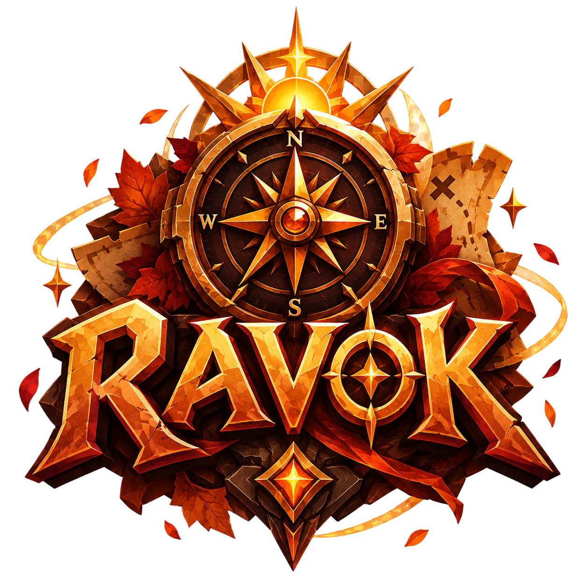
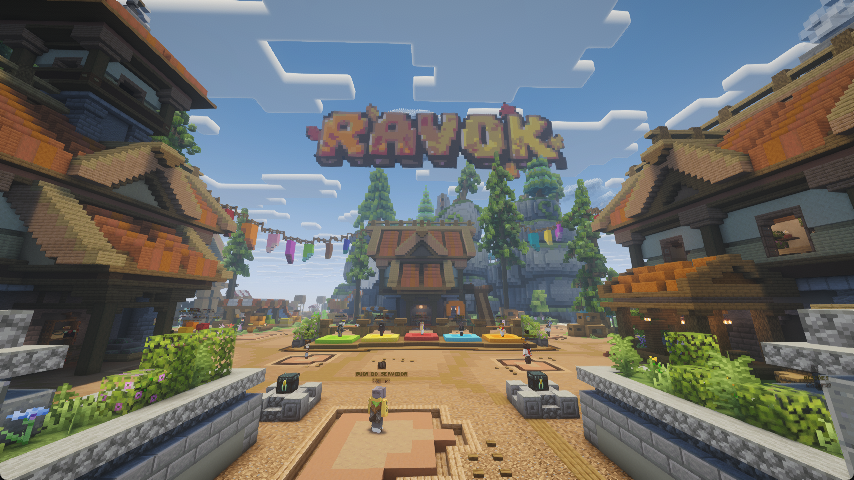
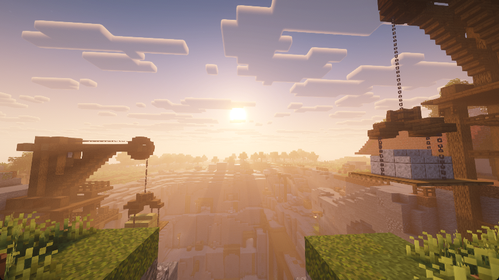
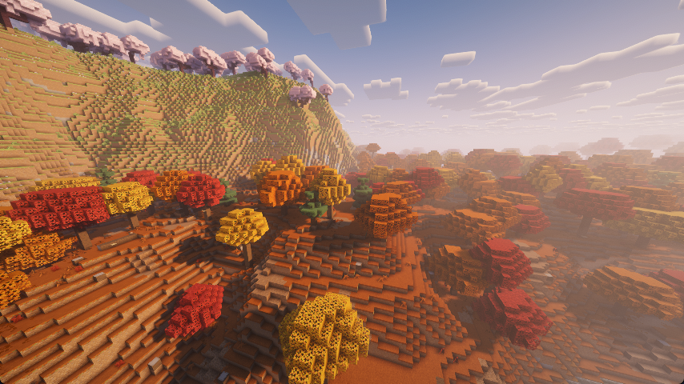
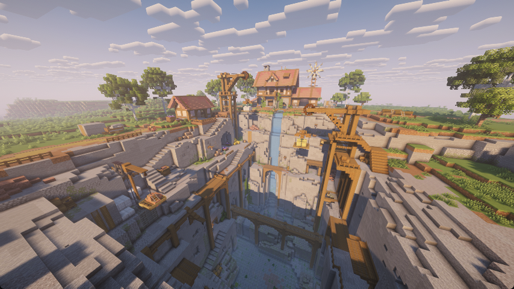
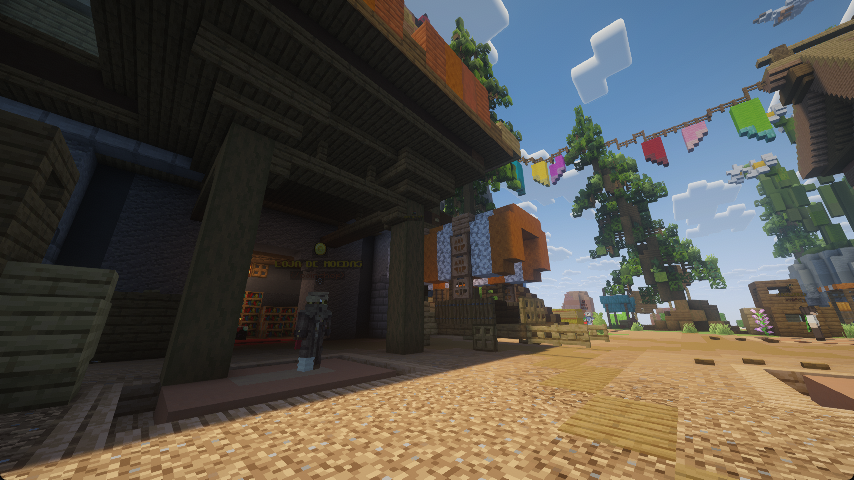
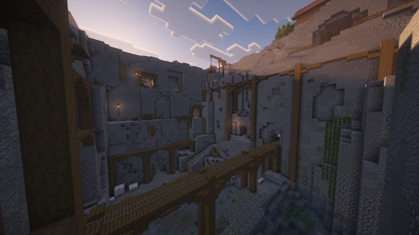

<p align="center">
  
</p>

<h1 align="center">🍂 RAVOK NETWORK — SEASON 3: OUTONAL</h1>

<p align="center">
  <b>Loja Oficial, Arena de Votos, Painel de Controle e Backend Serverless para Minecraft</b><br>
  Inspirado no design minimalista de alta performance da ReallyWorld, adaptado com a identidade visual da Temporada de Outono.
</p>

<p align="center">
  
  
  
  
  
</p>

---

## 📸 Capturas de Tela do Servidor & Galeria Oficial

### 🏛️ Spawn Central da Ravok
> *A grande praça central da Temporada 3 com decorações de outono, portais de exploração e NPCs de aventura.*
<p align="center">
  
</p>

---

### 🌅 Pôr do Sol no Cânion Ancestral
> *Iluminação poente refletindo sobre os guindastes de mineração, pontes de madeira e cânions rochosos.*
<p align="center">
  
</p>

---

### 🍁 Bosque das Folhas Douradas
> *Colinas outonais repletas de carvalhos rubros, árvores douradas e cerejeiras floridas em névoa atmosférica.*
<p align="center">
  
</p>

---

### ⛏️ Pedreira & Vila dos Trabalhadores
> *Complexo de extração com moinho de vento, cascata natural e sistema vertical de guindastes que abastecem o reino.*
<p align="center">
  
</p>

---

### 🪙 Mercado Oficial & Loja de Moedas (`/coinshop`)
> *Área comercial dos mercadores no spawn com carroças rústicas e troca de moedas por itens lendários e visuais.*
<p align="center">
  
</p>

---

### 🏰 Fortaleza & Mina Subterrânea
> *Cavernas profundas com pontes suspensas, trilhos de vagonetas e muralhas de pedra ancestral.*
<p align="center">
  
</p>

---

## 👑 Ranks VIP da 3ª Temporada

Cada rank possui benefícios progressivos, kits exclusivos, tags no chat/TAB e entrega imediata no Minecraft via comando console:

<p align="center">
  
  
  
  
  
  
</p>

| Rank | Tag | Preço | Principais Vantagens | Comando Console |
|---|---|---|---|---|
| **VIP VENDAVAL** | `[VENDAVAL]` | **R$ 14,90** | 5 homes, Kit Vendaval, `/feed`, `/back`, `/recipe`, `/disposal` | `lp user {player} parent settrack rank knight` |
| **VIP FLAMEJANTE** | `[FLAMEJANTE]` | **R$ 29,90** | 10 homes, Kit Flamejante, `/craft` virtual, radar `/near` | `lp user {player} parent settrack rank lord` |
| **VIP CARVALHO** | `[CARVALHO]` | **R$ 44,90** | 15 homes, Kit Carvalho, `/ec` (enderchest portátil), `/repair`, `/ptime` | `lp user {player} parent settrack rank paladin` |
| **VIP AURORA** | `[AURORA]` | **R$ 64,90** | 25 homes, Kit Aurora, `/heal` instantâneo, `/compactar`, `/hat` | `lp user {player} parent settrack rank duke` |
| **VIP SOLAR** | `[SOLAR]` | **R$ 89,90** | Homes ilimitadas, Kit Solar do Rei, voo `/fly`, imortalidade `/god` | `lp user {player} parent settrack rank king` |
| **VIP DEUSA** | `[DEUSA]` | **R$ 119,90** | Tag divina iridescente, todos os kits, `/repair all`, `/fly`, fila prioritária | `lp user {player} parent add deusa` |

---

## 🪙 Tabela Oficial de Moedas (Coins S3)

Economia integrada com o plugin **CoinsEngine** para gastar na `/coinshop`:

- **1.000 Moedas** — `R$ 9,90`
- **2.500 Moedas** — `R$ 19,90`
- **5.000 Moedas** — `R$ 34,90`
- **8.000 Moedas** — `R$ 49,90`
- **10.000 Moedas** — `R$ 59,90`
- **20.000 + 2.000 Bônus (22.000 Moedas)** — `R$ 99,90`

---

## 🗝️ Chaves Místicas & Vouchers

- **3x Chave de Voto S3** — `R$ 4,90`
- **Chave Comum S3** — `R$ 7,90`
- **Chave Rara S3** — `R$ 14,90`
- **Chave Épica S3** — `R$ 24,90`
- **Chave Superior S3** — `R$ 39,90`
- **Combo 4x Chaves Místicas** — `R$ 69,90`
- **Voucher Skin Aleatória** — `R$ 14,90` *(136 visuais exclusivos para espadas, picaretas e machados via CrazyVouchers)*

---

## ✨ Funcionalidades do Projeto

- 🚀 **Design System ReallyWorld**: Hero card dinâmico com personagens 3D flutuantes, carrossel de novidades, 4 colunas de produtos e barra lateral de categorias.
- 🎯 **Meta de Arrecadação Mensal**: Widget interativo no topo da página exibindo a meta de manutenção do servidor com marcos de recompensas coletivas (50% 2x XP, 75% Boss Mundial, 100% Sorteio VIP).
- 🗳️ **Arena de Votos Gamificada (`votar.html`)**: Os jogadores cumprem desafios interativos (Quiz sobre Minecraft, Enquete da comunidade, Pegadinhas e Trocadilhos) para receber Chaves de Voto automáticas no `/resgatar`.
- 🛡️ **Painel Administrativo Completo (`admin.html`)**: Gerenciamento em tempo real de produtos, galeria de fotos, pedidos, fila de entregas, configurações da Silvie IA e Webhooks do Discord.
- ⚡ **Deploy Serverless na Vercel**: Arquitetura híbrida com páginas ultra-rápidas na Edge CDN e endpoints Express em Serverless Functions (`/api/*`).
- 💳 **Mercado Pago Pix Instantâneo**: Geração de QR Code e chave Pix Copia e Cola com webhook de aprovação imediata.

---

## 🛠️ Como Rodar Localmente

1. Clone o repositório:
   ```bash
   git clone https://github.com/ravoknetwork/ravok-site.git
   cd ravok-site
   ```

2. Instale as dependências:
   ```bash
   npm install
   ```

3. Inicie o servidor:
   ```bash
   npm start
   ```

4. Abra no navegador:
   - **Loja Oficial**: [http://localhost:3000](http://localhost:3000)
   - **Arena de Votos**: [http://localhost:3000/votar.html](http://localhost:3000/votar.html)
   - **Painel Administrativo**: [http://localhost:3000/admin.html](http://localhost:3000/admin.html)

---

## ☁️ Deploy na Vercel

1. Faça um push deste repositório para o GitHub da organização:
   ```bash
   git push origin main
   ```
2. Na [Vercel](https://vercel.com), clique em **Add New... ➔ Project** e selecione `ravok-site`.
3. Configure as variáveis de ambiente em **Project Settings ➔ Environment Variables**:
   - `ADMIN_PASSWORD`: Senha de acesso do painel de controle.
   - `API_TOKEN`: Token de sincronização com o plugin do Minecraft.
   - `MP_ACCESS_TOKEN`: Token do Mercado Pago para geração de Pix.
   - `DISCORD_WEBHOOK_URL`: Webhook para alertas de compra no Discord.
4. Clique em **Deploy**! Em 60 segundos sua loja estará no ar com certificado SSL grátis.

---

<p align="center">
  <sub>© 2026 <b>Ravok Network</b>. Todos os direitos reservados. Não afiliado à Mojang Studios.</sub>
</p>
